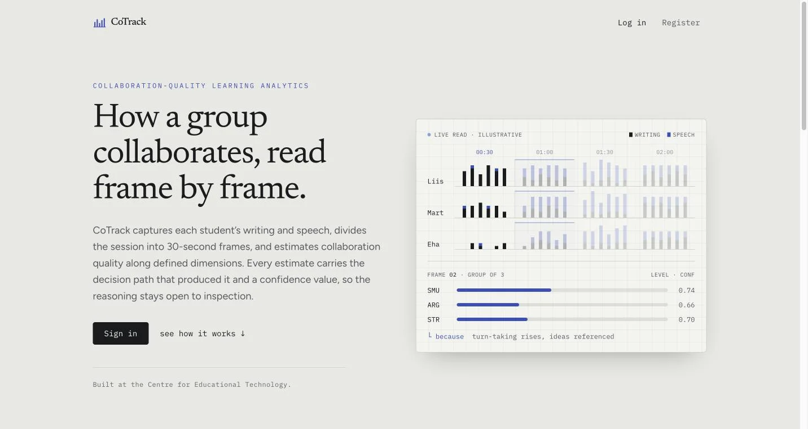

Laravel
React
Inertia.js
Laravel Reverb
MySQL
<a href="https://cotrack.ee" class="lab-detail-link">cotrack.ee</a>

# CoTrack

A teacher-facing learning analytics tool for collaborative group work. CoTrack captures each group's shared writing and speech, segments the session into 30-second frames, and estimates collaboration quality across seven dimensions, with every prediction explained rather than presented as a black-box score.

// 01

## Overview

Collaboration is hard to observe at classroom scale: a teacher moving between five groups sees only fragments of each. CoTrack is a multimodal learning analytics tool that gives the teacher a view of how each group's collaboration develops over a lesson, and lets earlier and later sessions be compared.

During group work, students write together in a shared editor while each student's microphone records their own speech. The session is divided into 30-second frames. For every frame, the system derives behavioural features from the writing and speech activity and predicts collaboration-quality dimensions at group level, plus individual engagement per student. Each prediction carries its decision path and a confidence value, so the teacher can see why the tool reached its estimate.

CoTrack is a ground-up rebuild of an earlier Django-based research prototype developed at the centre. The rebuild keeps the original research logic (feature pipeline, collaboration dimensions, 30-second frames, group-level collaboration quality) while replacing the browser-specific capture and speech recognition the prototype depended on.

### Workflow

1. **Lesson setup** — the teacher creates a lesson, a pseudonymous student roster, and groups
2. **Joining** — students join a live session with a session code and a personal code, with no student accounts or emails
3. **Capture** — group members write in a shared real-time editor while each student's device records their own speech
4. **Live analytics** — completed 30-second frames feed group analytics on the teacher dashboard during the lesson
5. **Post-session analysis** — when the session ends, features and predictions are rebuilt for the whole session
6. **Review and coding** — teachers and researchers inspect frames alongside the evidence, and human raters code frames against the codebook
7. **Comparison** — sessions of the same lesson can be compared to see how a group's collaboration changed over time

// 02

## Technical Architecture

Backend

Laravel, PHP (monolith)

Frontend

React via Inertia.js, Tailwind CSS

Real-time

Laravel Reverb (WebSockets) + Echo

Collaborative editing

Yjs CRDT relayed over Reverb, merged in the browser

Database

MySQL, JSON columns for decision paths

Prediction

Random forests trained offline in scikit-learn, transpiled to PHP and run in-process

Speech-to-text

Pluggable adapter

Languages

English, Estonian

### Architecture Seams

Components that are likely to change are kept behind interfaces, so a provider or model can be swapped without touching the rest of the system:

| Seam | Responsibility |
|------|----------------|
| `SpeechToTextAdapter` | Transcribes recorded audio segments; can be switched off entirely |
| `SpeakerAttributionAdapter` | Attributes speech to students when microphones pick up neighbours |
| `PredictionRegistry` | Maps each collaboration dimension to its model; a dimension without a model reports "not modelled yet" instead of a fabricated score |
| `EditorSyncDriver` | Relays collaborative-editing updates between group members |

Dimensions are stored as registry data rather than hard-coded, so the framework can be extended with new dimensions without code changes.

// 03

## Collaboration Quality Dimensions

CoTrack rates collaboration on a five-point scale (−2 to +2) per 30-second frame. Six dimensions describe the group as a whole, and one describes each student:

| Dimension | Level | Focus |
|-----------|-------|-------|
| **Collaboration flow** (CF) | Group | Whether students build on each other's contributions and keep a coherent discussion on the shared task |
| **Sustaining mutual understanding** (SMU) | Group | Whether ideas are explained, acknowledged, and clarified so a common understanding is maintained |
| **Knowledge exchange** (KE) | Group | How students externalise their thinking and make their ideas available to others |
| **Argumentation** (ARG) | Group | How students evaluate ideas, compare alternatives, justify their thinking, and negotiate decisions |
| **Structure and time management** (STR) | Group | How the group plans next steps, coordinates responsibilities, monitors progress, and manages time |
| **Cooperative orientation** (COOP) | Group | The social quality of collaboration: encouragement, acknowledgement, and shared responsibility |
| **Individual engagement** (IND) | Student | Each student's participation in the collaborative process |

Overall collaboration quality is an unweighted aggregate of the six group dimensions. It is never coded or modelled directly.

A researcher-authored codebook describes each level of each dimension in one sentence, in both English and Estonian. The codebook is built into the coding interface, so human raters work from the same descriptors the models are trained against.

// 04

## Multimodal Capture & Feature Pipeline

**Writing** — the shared editor is a CRDT, so concurrent typists' edits merge instead of overwriting each other. Every edit is logged per author, and these logs are the source of the writing features (characters added and deleted per student).

**Speech** — each student records through their own microphone in short segments aligned to the session's 30-second window grid. Voice activity detection runs in the browser, so speaking time, speech turns, and loudness are computed on the student's device. Wired clip-on microphones keep each stream close to single-speaker, which matters because built-in laptop microphones pick up the whole table.

**Pipeline** — when a session ends (and every minute during a live session), the system:

1. Frames the session into 30-second windows and assigns writing and speech activity to them
2. Extracts behavioural features per student and per group (mean and spread of writing and speech activity)
3. Runs the dimension models and stores each prediction with its score, confidence, and decision path

During a live session, only completed frames are predicted, never a half-elapsed window.

// 05

## Explainable Predictions

Each dimension is predicted by a random forest regressor. Models are trained offline in a separate research pipeline from human-coded classroom data, then transpiled to plain PHP so the production system runs without a Python runtime.

For every frame the teacher sees:

- **Score** — the mean of the trees' votes on the −2 to +2 scale
- **Confidence** — derived from how much the trees agree
- **Decision path** — a baseline plus the contribution of each feature, rendered as a plain-language explanation of why the score is what it is

The current models use writing features only. Speech activity, speech turns, and transcripts are shown to the teacher as evidence alongside the prediction, but are not yet model inputs; the next models will be retrained on classroom data captured through the tool itself.

// 06

## Teacher & Researcher Interfaces

**Group analytics** — a session overview or per-frame view of each group's predicted dimensions, a speaking sociogram showing how much each student spoke and which pairs shared airtime, an on-task keyword indicator, per-student writing and speech features, and the transcript.

**Coding grids** — human raters code group dimensions and individual engagement per frame, with the predicted values overlaid, the codebook at hand, and an evidence panel with audio playback for each segment.

**Comparison** — sessions of the same lesson side by side, so changes in a group's collaboration across lessons become visible.

**Exports** — tidy CSV exports of features, predictions, and coded labels for training and analysis. Raw audio is never exported.

**Guide** — an in-app guide explains each dimension and how far the predictions can be trusted.

// 07

## Data Privacy

- Students are a pseudonymous roster with personal join codes; no student accounts or email addresses
- Voice activity is computed in the browser, and only derived numbers leave the device besides the audio segment
- Teachers see only their own lessons and sessions (researchers have read access for analysis); teacher accounts require admin approval
- Minors' audio is sent to a hosted speech-to-text provider only under a data-processing agreement, with consent that names the provider

// 08

## Publications

CoTrack builds on a line of multimodal learning analytics research on estimating collaboration quality in authentic classrooms and on how teachers act on collaboration analytics.

2024

How well do collaboration quality estimation models generalize across authentic school contexts?
Chejara, P., Kasepalu, R., Prieto, L.P., Rodríguez-Triana, M.J., Ruiz-Calleja, A., & Schneider, B.
British Journal of Educational Technology, 55(4). DOI: 10.1111/bjet.13402

2024

The Impact of Attribute Noise on the Automated Estimation of Collaboration Quality Using Multimodal Learning Analytics in Authentic Classrooms
Chejara, P., Prieto, L.P., Dimitriadis, Y., Rodríguez-Triana, M.J., Ruiz-Calleja, A., Kasepalu, R., & Shankar, S.K.
Journal of Learning Analytics, 11(2), 73–90. DOI: 10.18608/jla.2024.8253

2024

Bringing Collaborative Analytics using Multimodal Data to the Masses: Evaluation and Design Guidelines for Developing a MMLA System for Research and Teaching Practices in CSCL
Chejara, P., Kasepalu, R., Prieto, L.P., Rodríguez-Triana, M.J., & Ruiz-Calleja, A.
Proceedings of the 14th Learning Analytics and Knowledge Conference (LAK24), Kyoto, Japan. ACM, 800–806. DOI: 10.1145/3636555.3636877

2023

Studying teacher withitness in the wild: comparing a mirroring and an alerting & guiding dashboard for collaborative learning
Kasepalu, R., Chejara, P., Prieto, L.P., & Ley, T.
International Journal of Computer-Supported Collaborative Learning, 18(4), 575–606. DOI: 10.1007/s11412-023-09414-z

2023

Exploring Indicators for Collaboration Quality and Its Dimensions in Classroom Settings Using Multimodal Learning Analytics
Chejara, P., Prieto, L.P., Rodríguez-Triana, M.J., Ruiz-Calleja, A., Kasepalu, R., Chounta, I.-A., & Schneider, B.
EC-TEL 2023, Aveiro, Portugal. Springer (LNCS 14200), 60–74. DOI: 10.1007/978-3-031-42682-7_5

2023

How to Build More Generalizable Models for Collaboration Quality? Lessons Learned from Exploring Multi-Context Audio-Log Datasets using Multimodal Learning Analytics
Chejara, P., Prieto, L.P., Rodríguez-Triana, M.J., Kasepalu, R., Ruiz-Calleja, A., & Shankar, S.K.
LAK23: 13th International Learning Analytics and Knowledge Conference. ACM, 111–121. DOI: 10.1145/3576050.3576144

2022

Do Teachers Find Dashboards Trustworthy, Actionable and Useful? A Vignette Study Using a Logs and Audio Dashboard
Kasepalu, R., Prieto, L.P., Ley, T., & Chejara, P.
Technology, Knowledge and Learning, 27(3), 971–989. DOI: 10.1007/s10758-021-09522-5

2022

Teacher Artificial Intelligence-Supported Pedagogical Actions in Collaborative Learning Coregulation: A Wizard-of-Oz Study
Kasepalu, R., Prieto, L.P., Ley, T., & Chejara, P.
Frontiers in Education, 7, 736194. DOI: 10.3389/feduc.2022.736194

2021

EFAR-MMLA: An Evaluation Framework to Assess and Report Generalizability of Machine Learning Models in MMLA
Chejara, P., Prieto, L.P., Ruiz-Calleja, A., Rodríguez-Triana, M.J., Shankar, S.K., & Kasepalu, R.
Sensors, 21(8), 2863. DOI: 10.3390/s21082863

2021

CoTrack2: A Tool to Track Collaboration Across Physical and Digital Spaces with Real Time Activity Visualization
Chejara, P., Prieto, L.P., Ruiz-Calleja, A., Rodríguez-Triana, M.J., Shankar, S.K., & Kasepalu, R.
Companion Proceedings of the 11th International Conference on Learning Analytics & Knowledge (LAK21). ACM, 406

2020

Quantifying Collaboration Quality in Face-to-Face Classroom Settings Using MMLA
Chejara, P., Prieto, L.P., Ruiz-Calleja, A., Rodríguez-Triana, M.J., Shankar, S.K., & Kasepalu, R.
CollabTech 2020, Tartu, Estonia. Springer (LNCS 12324), 159–166. DOI: 10.1007/978-3-030-58157-2_11

2020

MMLA Approach to Track Collaborative Behavior in Face-to-Face Blended Settings
Chejara, P., Kasepalu, R., Shankar, S.K., Prieto, L.P., & Rodríguez-Triana, M.J.
Companion Proceedings of the 10th International Conference on Learning Analytics & Knowledge (LAK20). ACM, 543–548

